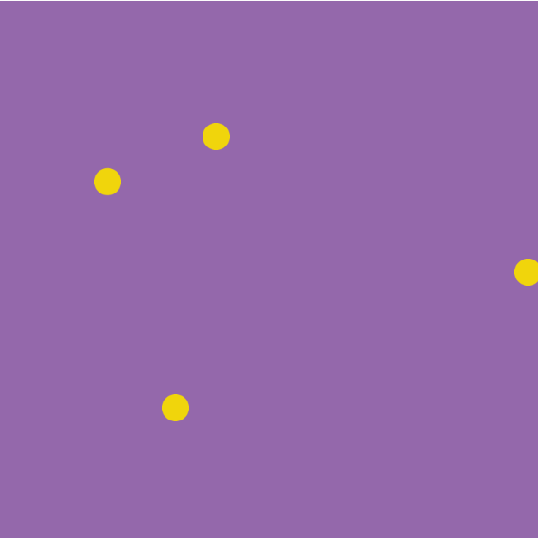
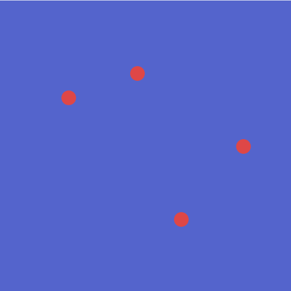
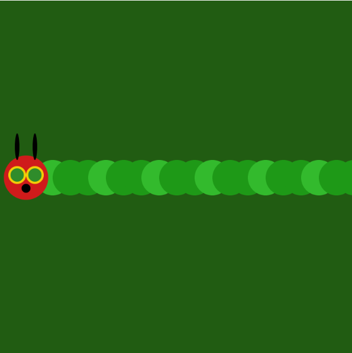
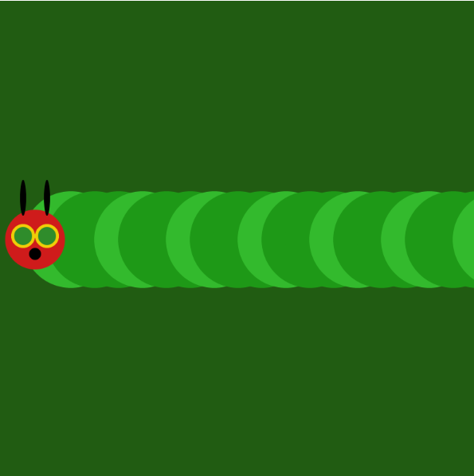

# Week 02 — Control Flows and Interactivity

<!-- Replace ## with the week number and Topic Name with the week's focus -->
<!-- You may also refer to each week's slide for the Topic Name -->
<!-- e.g. Week 03 — Arrays & Functions -->

---

### Activities

| Activity | What I Made                   |
| -------- | ----------------------------- |
| `2a`     | <!-- one line description --> Racing Ducks|
| `2b`     | <!-- one line description --> The Very Hungry Caterpillar|

<!-- Add or remove rows to match the activities for this week. -->

---

### This Week

<!-- A short, informal summary of what you explored across the week's activities. What did you make? What clicked? What didn't?
     A few sentences is all you need — write it like a journal entry, not a report. -->

     For the first activity, I wanted to play around with the different speeds. I lined up the different dots moving at different speeds to make it look like they r competing with one another. The colours are to look like ducks in the pond but can also change the pond colour with numbers '1', '2' and '3'. For the second activity, the circles overlapping one another really reminded me of this childhood story so I colour coded the different circles and created the face of the caterpillar. I also added the keypress command to expand the circles every time a key is pressed to make the caterpillar grow fatter. 

---

### Output






<!-- Drop a screenshot, photo, or GIF of something you made this week.
     Save it to a readme-assets/ folder inside this week's folder.
     Made more than one thing worth showing? Add more images. -->

---

<!-- ─────────────────────────────────────────────────────
     GOING FURTHER — if you want to document more, here are some ideas:

     ### 1a — Activity Name
     
     What you tried, what you discovered.

     ### 1b — Activity Name
     
     What you tried, what you discovered.

     ### 🧩 Something I Found Interesting
     A line of code, a technique, a happy accident — paste it here.
     ```js
     // your code here
     ```

     ### ❓ Questions I'm Sitting With
     Anything unresolved, something you want to revisit, or a rabbit hole you fell into.

     ### 🔗 References
     Links to anything that helped or inspired you this week.
     ───────────────────────────────────────────────────── -->
