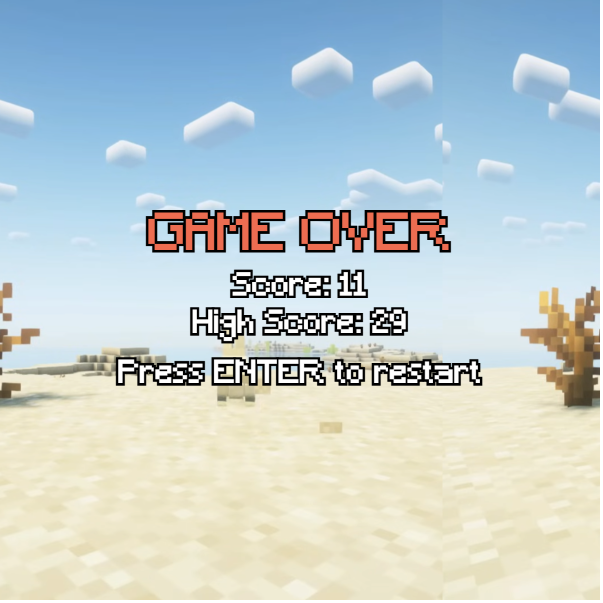
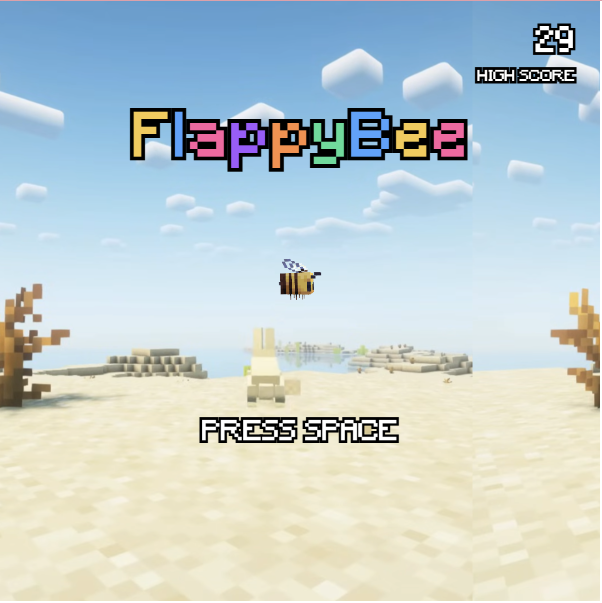

# Mini Project — FlappyBee by LiTing and Priscilla

---

### The Project

<!-- What did you build and what makes it yours? A few sentences is enough.
     What did you change, add, or push beyond the scaffold? -->

     Our game is inspired by Minecraft and Flappybird. We changed the bird into a bee mob, pipes into cactus blocks and background into a desert biome. We added the GAME OVER screen, Mincraft font, Minecraft audio and Minecraft damage audio. Pushing beyond the scaffold, we also made the background loop, added a high score function and made the background audio continue playing instead of restarting after each death.

---

### Output




<!-- Drop a screenshot or GIF of your finished project.
     Save it to a readme-assets/ folder inside this project folder.
     Got more than one good screenshot? Add them. -->

[Watch Online](readme-assets/video-06.mp4)

<!-- Replace the link above with a URL to a screen recording or video of your project.
     ⚠️ Make sure the file or page is set to public before submitting. -->

---

### ✍️ Reflection

<!-- 200–300 words on your process. Write freely — this isn't an essay.
     Some prompts to get you started:
     — What did you set out to make, and how did the result compare?
     — What inputs does your sketch respond to, and how did you approach that?
     — What was your biggest challenge, and how did you work through it?
     — What would you push further if you had more time? -->

     For our project, we chose "Flappy Bird" because it reminded us of our childhood and offered strong potential for customization.
     
     We kept the original gameplay mechanism whereby players press the spacebar to start and the bird flies through the pipes, earning a point for every gap successfully cleared. Hitting a pipe ends the game and directs the player to a GAME OVER screen, where pressing "Enter" restarts the run. The scoring system features a live counter at the top of the screen during gameplay, alongside a high score display on the GAME OVER page that saves progress even when the code is refreshed.
     
     We redesigned the visual and auditory aesthetics around a Minecraft desert theme. The traditional bird was replaced with a Minecraft bee mob, and the pipes were changed into cacti. Since cacti naturally gives damage to players in Minecraft logic, we felt that this would be a fitting block to replace the pipes. We also incorporated Minecraft music to make gameplay more immersive. The background music plays throughout the run, cutting off instantly upon death, and a "ouf" Minecraft damage sound effect triggers when the bee collides with a cactus.
     
     The main challenge we encountered was initial difficulty understanding the template's logic, particularly with the pipe generation. We also struggled with looping the cactus block image along the pipe without stretching it out. However, after seeking guidance to understand the foundational code structure, the rest of the customization process went smoothly.

     To push it further, we might add different levels of difficulty and more biomes the bee can travel through to make the game more interesting. But ultimately, we think the game works well and we are happy with the final gameplay.

---

<!-- ─────────────────────────────────────────────────────
     GOING FURTHER — want to document more? Try any of these:

     ### ✨ What I Changed
     A short list of the additions and modifications you made to the scaffold.
     - Changed the paddle to use mouse tracking instead of keyboard
     - Redesigned the visual language with a retro CRT aesthetic

     ### 🔍 Code Structure
     Briefly explain how your files are organised.
     - `sketch.js` — main game loop
     - `Ball.js` — ball class with collision logic
     - `assets/` — sprites and sounds

     ### 🧩 Something I'm Proud Of
     A snippet of code, a design decision, a moment where it clicked.
     ```js
     // your code here
     ```

     ### 🔗 References
     Anything that helped or inspired you — tutorials, artworks, tools.
     ───────────────────────────────────────────────────── -->
