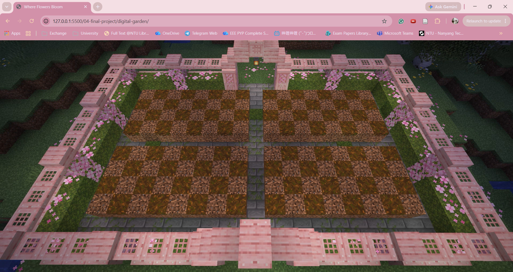
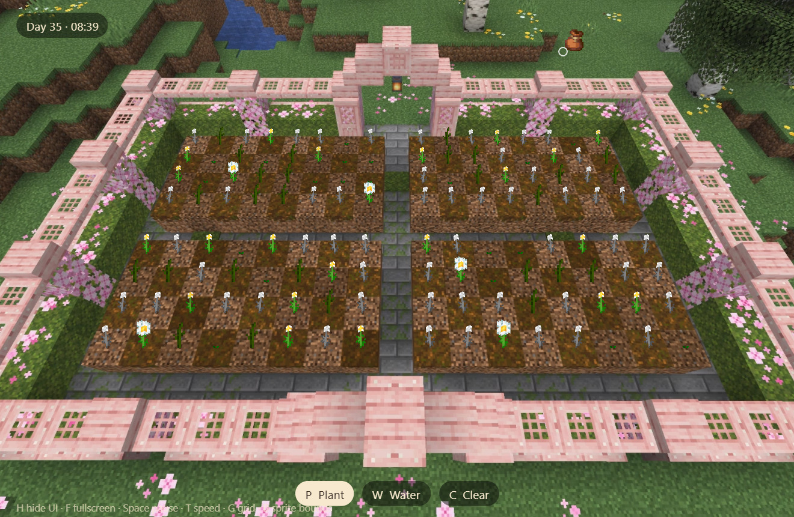
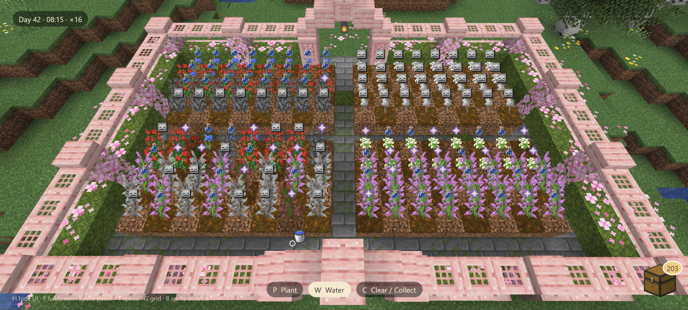

# Final Project — Where Flowers Bloom by Priscilla & LiTing

<!-- Replace "Title" with the name of your project -->

---

### The Project

<!-- What is your project and what does it do?
     What experience does it create, and who or what does it respond to?
     A short paragraph is ideal — make it something you'd be happy for anyone to read. -->

     Our project is a digital gardern that can be an interactive wallpaper. Taking inspiration from interactive widgets or digital pets on screens, we were wondering if we could create an interactive wallpaper designed as a form of relaxation to have on a user's backgrounds. Following the minecraft aesthetic from our flappy bird assignment, we wanted to create a minecraft garden for users to plant, water and collect flowers. Because some people may not have space for an actual gardern or maybe just like interactive widgets on their devices, they can use our project to meet their gaderning needs or just have as something playing in the background to interact and have fun with.

---

### Output





<!-- Drop a screenshot or GIF of your project.
     Got more to show? Add more images — let the work speak for itself.
     Save everything to a readme-assets/ folder inside this project folder. -->

[Watch Online](https://your-link-here)

<!-- Replace the link above with a URL to a screen recording or video of your final project.
     ⚠️ Make sure the file or page is set to public before submitting. -->

---

### ✍️ Reflection

<!-- 200–300 words on your process and outcome. Write freely — this is your story to tell.
     Some prompts to get you started:
     — What did you set out to create, and how did the final result compare to your original vision?
     — How is your project structured — what inputs does it respond to and how did you approach the code?
     — What were your key visual and/or sonic design decisions, and why?
     — What was your biggest challenge, and how did you work through it?
     — What would you change, add, or explore further given more time? -->

     We set out to create an interactive digital garden wallpaper and the final results was what we expected. With that being said, the original version in our minds did not have as many functions as there are now because as we worked on the project we kept discovering more ways to improve the project to make it even better than before. The main structure of the project is that the day reflects the time in real life (can be sped up for testing) and the plants grow in 4 stages: seed > shoot > unbloomed > bloomed and can die at any point if it is not watered. The keypress "P", "W" and "C" is to plant, water and clear/collect and each keypress is selected before using mousepress to carry out its function. We also included many assets like the flower species, tool icons, ui visuals and the moving background which are all from minecraft but we manipulated some of them to fit our idea. For instance, the chest and bundle ui don't actually look like that in minecraft, i had to edit the images. The sound effects we chose also are minecraft audio which we linked to actions to make the interaction more clear for users. The biggest challenge would be the debugging of the code as we did generate some of the instructions on how to make our digital gardern from claude but it doesn't always work, so we had to look through the code ourselves to find mistakes that the ai may have made. Additionally, we also realised we had to compress our assets as there were a lot and made the visuals lag. We are really happy with the results so i don't think we would change anyhting but given more time i do think we could expand this interactive wallpaper idea to carry multiple visuals, so not just one type of garden but multiple that users can decorate as well.

---

<!-- ─────────────────────────────────────────────────────
     GOING FURTHER — want to document more? Try any of these:

     ### ✨ Features
     A short list of what your project does.
     - Responds to mouse position and velocity
     - Generates sound based on particle density

     ### 🔍 Code Structure
     How are your files organised?
     - `sketch.js` — main setup and draw loop
     - `Agent.js` — autonomous agent class
     - `assets/` — images and sounds

     ### 🛠️ Hardware (if applicable)
     List any physical components used.
     - Arduino Uno
     - Sensor type and model

     ### 🧩 Something I'm Proud Of
     A snippet, a decision, a moment where it all came together.
     ```js
     // your code here
     ```

     ### 🔗 References
     Tutorials, libraries, artworks, or research that informed your project.
     ───────────────────────────────────────────────────── -->
